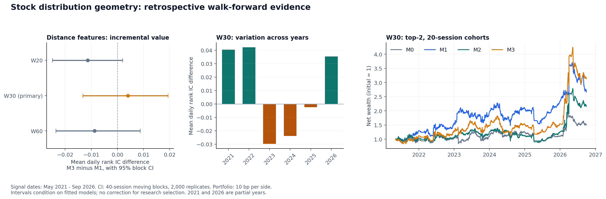

# 個別銘柄の分布変化 × ランキング学習：実験115の結果

実施日：2026-10-27〜28（日本時間）。専用ブランチ：`research/stock-distribution-geometry-20261026`。
[研究設計・計算式・再実行方法](STOCK_DISTRIBUTION_GEOMETRY.md)。

## 結論

**30日窓では、符号付き平均・標準偏差変化を超える距離特徴の追加効果を確認できなかった。**
主比較M3−M1の平均rank IC差は **+0.00405**、40営業日ブロック・ブートストラップの95%区間は
**[−0.01323, +0.01932]**。効果がないと証明した結果ではなく、改善を結論づけるには不確実性が大きい。
年別の差も改善3年・悪化3年だった。順位指標・運用成績の双方が一貫して改善したという結果ではない。

20日窓では差が−0.01139、95%区間[−0.02489, +0.00194]となり、点推定の符号も安定しなかった。
60日窓も差が−0.00875、95%区間[−0.02353, +0.00872]だった。
**20・30・60日窓のいずれも区間がゼロをまたぎ、安定した追加効果を裏付ける結果は得られなかった。**
本番採用・マージは行っていない。



[図のSVG版](assets/stock_distribution_geometry_results.svg)。

## 固定した条件と対象

| 項目 | 実行内容 |
|---|---|
| データ | 2026-10-26更新のリリースから再構築。日足10,199,091行、データセット22,026行・520列・3,739銘柄 |
| 候補 | 既存の78週高値更新・20営業日の間隔・流動性等の条件を継承 |
| 評価 | 2021-05-06〜2026-09-25、11期間、各条件16,409件・3,472銘柄・1,294シグナル日 |
| 順位指標 | 候補5件以上の1,057日。日付を等重みとして集計 |
| 既知ラベル | 評価対象の20日先リターン欠測は1件。予測からは除かず、指標では欠測を保持 |
| 分割 | 初期36か月、テスト6か月、拡大型。外側・内側ともラベル確定日によるpurge＋1営業日embargo |
| 学習 | LambdaRank。各条件・各期間で同じ4候補×200本、内側6か月で選択して再学習。種42 |
| 特徴 | W=30、ラグ5/20/60。厳密な正規分布のFisher–Rao距離、velocity、MA10、過去のみのz60 |
| 主比較 | W30のM3−M1の平均rank IC。M0との比較、その他の指標・窓は補助分析 |

保存済み本番LTRのパラメータは使わず、M0も同じ手順で再学習した。
既存特徴量の過去の選択や、現在のデータ版による回顧的検証という制約は残る。

## 30日窓：順位指標

| 条件 | 入力列数 | rank IC | NDCG@5 | 上位2件の20日収益 | 上位−下位2件 |
|---|---:|---:|---:|---:|---:|
| M0：既存 | 360 | 0.08377 | 0.61125 | 1.475% | 3.053pt |
| M1：符号付き変化追加 | 366 | 0.08515 | 0.61982 | 1.391% | 2.520pt |
| M2：距離・動態追加 | 366 | 0.09058 | 0.61369 | 1.233% | 2.899pt |
| M3：両方追加 | 372 | 0.08920 | 0.61789 | 1.297% | 2.816pt |

上位・下位の収益は翌営業日の調整後始値から20営業日後の調整後終値への収益。
候補4件以上の日で集計し、選択後のリターン欠測を別銘柄に置き換えない。
期間が重なるため、この平均を累積したり年率換算したりしない。

| M3−M1 | 差 | 条件付き95%区間 | 比較日数 |
|---|---:|---:|---:|
| rank IC（主比較） | +0.00405 | [−0.01323, +0.01932] | 1,057 |
| NDCG@5 | −0.00193 | [−0.01075, +0.00653] | 1,057 |
| 上位−下位収益 | +0.296pt | [−0.384pt, +1.175pt] | 1,138 |

区間は40営業日の移動ブロックを2,000回再標本化したもの。欠測日を詰めず、同じ日の条件間の差を使う。
モデルの再学習や多重探索全体を含む信頼区間ではない。
rank ICは、保存した予測から別の順位の積和計算でも同じ値になることを確認した。

### 年ごとの主比較

| 年 | M1 rank IC | M3 rank IC | M3−M1 |
|---|---:|---:|---:|
| 2021（5月以降） | 0.09949 | 0.13997 | +0.04047 |
| 2022 | −0.00322 | 0.03891 | +0.04213 |
| 2023 | 0.11519 | 0.08555 | −0.02964 |
| 2024 | 0.08081 | 0.05707 | −0.02374 |
| 2025 | 0.13476 | 0.13234 | −0.00242 |
| 2026（9月まで） | 0.04389 | 0.07926 | +0.03538 |

## 窓の感度分析

| 窓 | M1 rank IC | M3 rank IC | M3−M1 | 95%区間 |
|---|---:|---:|---:|---:|
| 20日 | 0.09994 | 0.08855 | −0.01139 | [−0.02489, +0.00194] |
| 30日（主比較） | 0.08515 | 0.08920 | +0.00405 | [−0.01323, +0.01932] |
| 60日 | 0.10267 | 0.09392 | −0.00875 | [−0.02353, +0.00872] |

窓の比較でも候補行・ラベル・分割・探索回数を揃えた。
M2は20日窓でrank ICが0.10277、60日窓では0.09640だった。
距離特徴だけを加えたM2の点推定が高い場合もあるが、主比較をM2や別の窓へ置き換えない。
年別のM3−M1は20日窓で6年すべて負、60日窓では改善2年・悪化4年だった。
20日窓では上位−下位収益の差も−0.650pt（条件付き95%区間[−1.379pt, −0.020pt]）。
これは補助比較であり、多重探索を補正した確認的な検定とは扱わない。

片道10bpのコストを入れた感度分析の運用成績：

| 窓 | 条件 | 年率収益 | Sharpe | 最大DD |
|---|---|---:|---:|---:|
| 20日 | M0 | 8.05% | 0.399 | −33.73% |
| 20日 | M1 | 30.66% | 0.959 | −24.16% |
| 20日 | M2 | 5.58% | 0.330 | −39.00% |
| 20日 | M3 | 13.00% | 0.567 | −34.39% |
| 60日 | M0 | 8.05% | 0.399 | −33.73% |
| 60日 | M1 | 評価不能 | 評価不能 | 評価不能 |
| 60日 | M2 | 19.10% | 0.676 | −27.27% |
| 60日 | M3 | 12.19% | 0.498 | −44.71% |

60日窓のM1は保有中の調整後終値に欠測があり、全コスト設定で運用成績を`unverified`とした。
元の日足との独立照合でも、2021-09-03の保有中終値1件の欠測を確認した。
取引を除外したり価格を補完したりせず、この条件の運用成績による優劣は判断しない。
順位指標の比較は実施できている。20日窓のM3はM1より年率収益が17.65pt低く、
30日窓で見られた運用成績の上積みも窓を変えると維持されなかった。

## 30日窓：売買コスト込みの比較ポートフォリオ

20営業日ごとの固定日程で上位2銘柄を翌営業日寄りに購入し、20営業日目の引けで売却。
空き枠は現金、各枠は資産の半分。2021-05-07〜2026-09-29の1,320営業日・66コホート。
以下は**片道10bp**、日次時価評価、252日年率換算、Sharpeの無リスク金利0。

| 条件 | 累積収益 | 年率収益 | Sharpe | 最大DD | 年率売買代金/NAV |
|---|---:|---:|---:|---:|---:|
| M0 | 50.02% | 8.05% | 0.399 | −33.73% | 24.05倍 |
| M1 | 166.62% | 20.59% | 0.719 | −35.30% | 24.05倍 |
| M2 | 116.27% | 15.87% | 0.588 | −36.60% | 24.03倍 |
| M3 | 213.39% | 24.37% | 0.772 | −37.86% | 24.01倍 |

30日窓の全4条件・4コスト設定で保有中の価格欠測による評価不能はなく、選択後に寄れず見送った購入も0件。
M3はM1より年率収益が3.78pt高いが、最大DDは2.55pt深い。
固定日程の少数銘柄への投資であり、毎日の上位平均収益の優劣とは一致しない。
開始日の位相をずらす追試や、ポートフォリオ差の信頼区間は今回実施していない。
本番の3枠・10%利確の規則を再現した成績ではない。

| 片道コスト | M0年率 | M1年率 | M2年率 | M3年率 |
|---|---:|---:|---:|---:|
| 0bp | 10.68% | 23.53% | 18.69% | 27.40% |
| 5bp | 9.36% | 22.05% | 17.27% | 25.87% |
| 10bp | 8.05% | 20.59% | 15.87% | 24.37% |
| 25bp | 4.22% | 16.32% | 11.76% | 19.96% |

## 層別・データの診断

- **下落モメンタムは十分に検証できない。** OOS16,409件のうち、直近20日モメンタム非負が16,250件、負が144件、欠測15件。
  負の群だけで候補5件以上となる日は0日。高値更新の母集団なので、「下落×高FID」の順位効果をこの実験から結論づけない。
- TOPIXが200日線より下の113日ではM3−M1のrank IC差は+0.04710、上の944日では−0.00111。
  層別は記述的な比較で、ここから後付けで運用条件を選ばない。
- 基準FID（ラグ20）のOOS Spearman相関は、`vol_20d`と0.31670、`ret_20d`と0.36057。
  既存指標と完全に同じではないことと、将来順位に役立つことは別の問い。
- W30のFID20はOOS242件（1.47%）で欠測。全期間のz60欠測率は8.07%、2020年では34.23%。
  入力の2020-10-01はカレンダー上営業日だが4,047行すべて価格/出来高条件を満たさず、完全窓を要求する特徴へ欠測が伝播する。
  同日は[JPXが公表した全銘柄の終日売買停止](https://www.jpx.co.jp/english/news/1030/20201001-05.html)に一致する。
  市場全体の停止を別扱いする追試は未実施。欠測行を条件別に落とすことはしていない。

## 解釈の限界と次の判断

今回の正規分布近似で扱うのは平均と標準偏差の変化であり、裾や歪度の形状そのものではない。
距離はそれらの非線形変換なので、検証対象は特徴量表現による追加効果になる。

現在のデータ版、既存の特徴量選択、ラベル未確定行の除外、上場廃止を含む母集団の完全性などの制約は継承している。
配当再投資・廃止時回収額・市場インパクトは再構築していない。
完全な将来の未使用期間で実証された予測優位性とは解釈しない。

主比較の改善が未確認なので、市場との関係を加える次段階Bを先行させない。
追加の研究を行うなら、母集団と欠測処理を先に固定し、全条件共通の完全観測行・別の母集団・将来期間で再検証する。
今回の結果を見て窓や層別条件を選び、その同じ評価期間で有効性を主張することは避ける。

## 再現性と検証

基準commit：`f7eaa37917c81108b2b775866ace8d74b5e54ab8`。
データセットSHA256：`ec5023fbd183318f52fead47c7ef10a166dd56807e08e01c779e870497cba0e3`。
実行コード7ファイルと各入力のSHA256、依存ライブラリ版は各実行のmanifestに保存した。

```bash
OMP_NUM_THREADS=2 OPENBLAS_NUM_THREADS=1 python research/exp/e115_distribution_geometry.py \
  --windows 30 --out research/_data/oof/e115_w30_seed42_20261027
OMP_NUM_THREADS=2 OPENBLAS_NUM_THREADS=1 python research/exp/e115_distribution_geometry.py \
  --windows 20,60 --out research/_data/oof/e115_sensitivity_seed42_20261028
```

再実行時は新しい`--out`を指定する。8GB環境でのデータ再構築方法は研究設計書に記載。
各期間・条件の途中保存に対応しており、中断後は元のコマンドに`--resume`を追加する。
入力・コード・設定・ライブラリ版が変わった場合は再開を拒否する。
30日窓はこの再開機能の追加前に実行し、当時のコードを同実行フォルダの`source_snapshot/`に保存した。
銘柄別データと予測値はgit対象外の`research/_data/`に置き、公開用の文書には集計値のみを記載する。

| 検証 | 結果 |
|---|---|
| 幾何特徴と評価手順のテスト | 20件成功（実際のLightGBM学習、未来ラベル改変への不変性を含む） |
| 既存LTRのテスト | 9件成功 |
| 既存データセット・テクニカル・実験114関連の回帰テスト | 253件成功 |
| データ構築の省メモリ変更 | 元コードと20銘柄で比較し、103行・520列が完全一致。元コードによる全銘柄比較はメモリ制限で未実施 |
| W30実データ監査 | 入力/ソースのハッシュ、全条件の対象行・ラベル、探索回数、学習境界、資産曲線の計算が一致 |
| 全窓の実データ監査 | 3窓×4条件×11期間の132モデルを監査。M0の予測は窓を変えても完全一致。評価可能な資産曲線の収益・DD・コスト単調性を照合 |
| 中断・再開 | 再開時の学習省略と予測完全一致、入力変更・保存ファイル破損の拒否をテスト |

30日窓の結果は`research/_data/oof/e115_w30_seed42_20261027/`。
監査集計は`research/_data/oof/e115_audit_20261027.json`。
20・60日窓の結果は`research/_data/oof/e115_sensitivity_seed42_20261028/`。
30日窓の実行時ソースは保存したスナップショットと照合し、感度分析の実行時ソースは現在のコードと照合した。
未完了の旧実行`e115_w30_seed42/`は中断として記録し、今回の結果には混ぜていない。
同様に、旧感度分析`e115_sensitivity_seed42_20261027/`も集計には含めていない。
